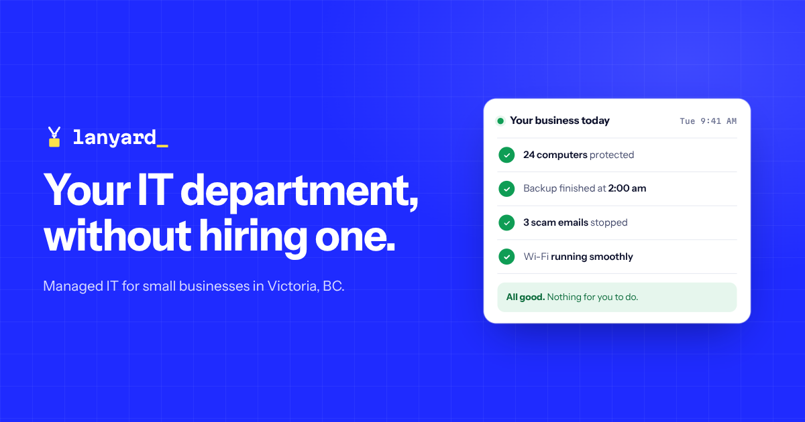

# Lanyard Systems · website



The website for **Lanyard**, the IT department for companies that don't have one. Based in Victoria, BC.

It's a static site: no build step, no framework, no dependencies, no cookies, no trackers. Drop the folder on any web host and it works.

> **Lanyard** is a working name. See [Renaming the company](#renaming-the-company) when you pick the real one.

---

## Preview it

```bash
python3 -m http.server 8000
```

Then open <http://localhost:8000>. Add `?noboot` to skip the boot screen while you work (it plays once per browser session anyway).

## The idea: show, don't tell

The page is **one workday at a client company**, from first login to last logoff. As you scroll, a sticky clock runs from 07:30 to 18:00, the sun crosses the sky and the sky changes colour. Each hour is one service, shown working instead of described:

| Time | Scene | What you see |
|---|---|---|
| 08:00 | office in a box | A box opens; laptop, firewall, switch, Wi-Fi and phone come out configured and go online |
| 09:00 | first login | A new hire's badge is issued and mail, Teams, files, CRM, Wi-Fi and laptop connect to it |
| 10:00 | patches, in rings | 63 devices patch in rings (pilot, early, broad); the visitor's own device is the yellow tile |
| 11:12 | phishing, quarantined | An inbox fills; a lookalike-domain email is caught and quarantined |
| 12:30 | threat hunted | A radar sweep finds malware on one laptop, isolates it and cleans it |
| 13:05 | fixed in 12 minutes | A help desk ticket runs from new to resolved, timer and rating included |
| 14:00 | backups, tested | A deleted file is restored from an hourly snapshot |
| 15:30 | network, locked down | Live packets through the firewall; probes get dropped; a new access point comes online |
| 16:10 | calls, routed | A call hits the phone menu, "1" goes to sales, the line connects |
| 17:00 | last logoff | Every access line is cut and the badge is stamped REVOKED |
| 18:00 | we keep watch | A heartbeat line for 24/7 monitoring |

Around it: a BIOS-style boot screen built from the visitor's real device, a WebGL hero that ray-marches 3D endpoints and draws them as ASCII, a tmux-style status bar, a pricing calculator, the founder's ID badge on a physics-simulated lanyard (drag it), a man-page FAQ, a contact form that previews the ticket as JSON, and a terminal on the <kbd>`</kbd> key (try `help`, `git log`, `scan`, `ping`).

Each scene replays when it scrolls back into view, and looping animations pause while off screen. With reduced motion, every scene shows its finished state. Without JavaScript, the page still reads top to bottom.

## Before you go live

1. **Domain.** Replace `lanyard.example` in `index.html` (canonical, Open Graph, JSON-LD), `robots.txt`, `sitemap.xml`, `.well-known/security.txt`, `assets/js/config.js` and `deploy/nginx/lanyard.conf`.
2. **Email.** Replace `hello@lanyard.example` in `assets/js/config.js`, `index.html` and `humans.txt`, and `security@lanyard.example` in `.well-known/security.txt`.
3. **Prices.** The calculator uses MYComputing's guide prices ($30 / $100 / $225 per person per month). Change them in one place: `prices` in `assets/js/config.js`. Also update `cat plans.txt` in `assets/js/terminal.js`.
4. **Contact form.** By default, submitting opens the visitor's email app with the ticket filled in. To receive tickets directly, put a form endpoint (Formspree, Basin or your own API) in `formEndpoint` in `assets/js/config.js`, and add its origin to `connect-src` in your Content Security Policy.
5. **Check the claims** you're committing to: on-site across Greater Victoria, 24/7 on request, the FAQ answers, and the services shown (several come through your MYComputing partnership).
6. **Training.** ITIL 4 Foundation and CompTIA Security+ are listed as *training*, because the CV shows the courses but not exam results. If you passed, say *certified* in the About section of `index.html`.
7. **Your background.** The About section describes your current job only as "a secure federal defence environment". Check what your employer allows public servants to say publicly, and its rules on outside work.
8. **Security.txt** expires on 2027-11-01. Update it before then.

## Deploy

Upload everything **except** `deploy/` and `tools/` to the root of your domain (the 404 page uses root-relative paths).

| Host | Notes |
|---|---|
| **Netlify** or **Cloudflare Pages** | Drag and drop or connect this repo. `_headers` applies security and caching headers. `404.html` is picked up automatically. |
| **Apache / shared hosting** | `.htaccess` sets headers, compression, caching and the 404 page. Uncomment the HTTPS redirect if your host doesn't already do it. |
| **nginx** | `deploy/nginx/lanyard.conf` + `deploy/nginx/security-headers.conf`. Steps are in the comments. Certificates via `certbot`. |
| **GitHub Pages** | Works, but can't set custom headers. |

All configs send a strict Content Security Policy (`default-src 'self'`, no `unsafe-inline`). The site has no inline scripts or styles and makes no third-party requests, and it was tested running under that policy.

## Renaming the company

1. Regenerate the logo files (the wordmark is converted to outlines):
   ```bash
   pip install fonttools brotli
   python tools/make_brand.py --name newname
   ```
2. Search and replace `Lanyard` / `lanyard` across `index.html`, `404.html`, `assets/js/*.js`, `site.webmanifest`, `humans.txt` and this README. The strap text on the founder badge is in `index.html`.
3. Regenerate the images: `node tools/render-images.js && python tools/make_favicon.py && rm tools/.favicon-*.png` (needs Node, Playwright and Pillow).

The mark (a lanyard strap, an RJ45 network-plug clip, and an ID card that doubles as a terminal cursor) isn't tied to the name.

## Brand

| Token | Value | Use |
|---|---|---|
| Setup Blue | `#1f2bff` | The BIOS-screen field: hero, footer, sky, primary plan |
| Select Yellow | `#ffe14a` | Highlighted option: cursor, focus, the sun |
| Phosphor | `#5ff3ff` | Live things on dark: links, packets, signals |
| Ink | `#0b0f2a` | Text on light |
| Paper | `#eef0f6` | Light background |

Type: **Martian Mono** (display, labels, data) and **Atkinson Hyperlegible Next** (reading), both self-hosted. Logo files are in `assets/brand/`.

## Structure

```
index.html              the site
404.html                not-found page
assets/
  css/main.css          all styles; colour tokens at the top
  js/
    config.js           your settings: email, form endpoint, prices, time zone
    scenes.js           the ten scene animations
    day.js              the scroll clock, sun, sky and scene triggers
    plans.js            the pricing calculator
    ascii.js            WebGL ray-marcher and ASCII renderer (hero)
    badge.js            verlet-rope lanyard and Code 39 barcode
    boot.js             boot screen
    contact.js          ticket form
    device.js           what the browser reveals about the visitor's device
    terminal.js         the ` terminal
    ui.js               status bar, clocks, theme, ticker, counters
  fonts/                WOFF2 files and their licences
  brand/                logo files
  img/og-image.png      social share image
_headers, .htaccess     host configs
deploy/nginx/           nginx configs
tools/                  logo and image generators (don't deploy)
```

## Credits

- Martian Mono © The Martian Mono Project Authors (Evil Martians), SIL Open Font License 1.1, `assets/fonts/OFL-MartianMono.txt`
- Atkinson Hyperlegible Next © The Atkinson Hyperlegible Next Project Authors (Braille Institute), SIL Open Font License 1.1, `assets/fonts/OFL-AtkinsonHyperlegibleNext.txt`
- Product names belong to their owners and are used only to describe compatible services.
